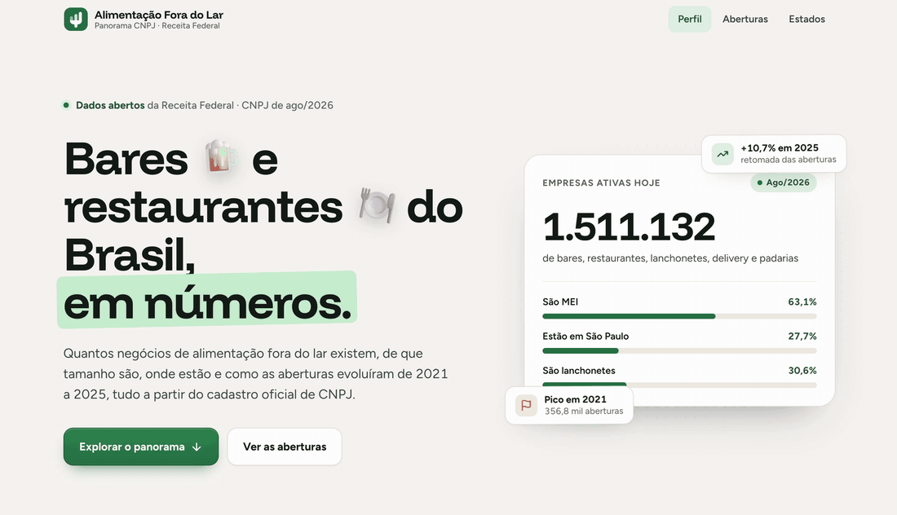
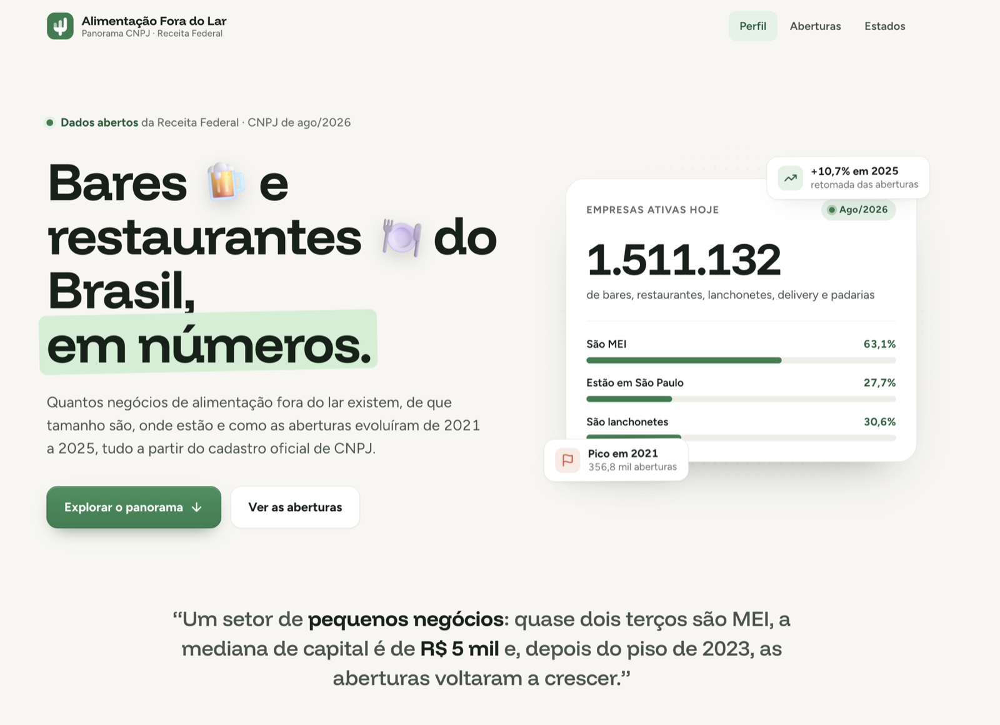
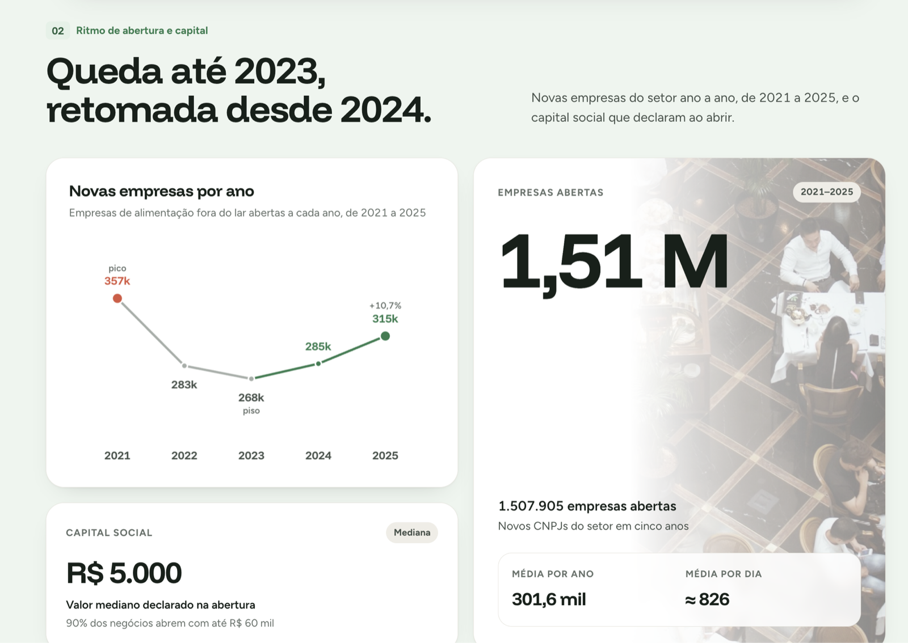
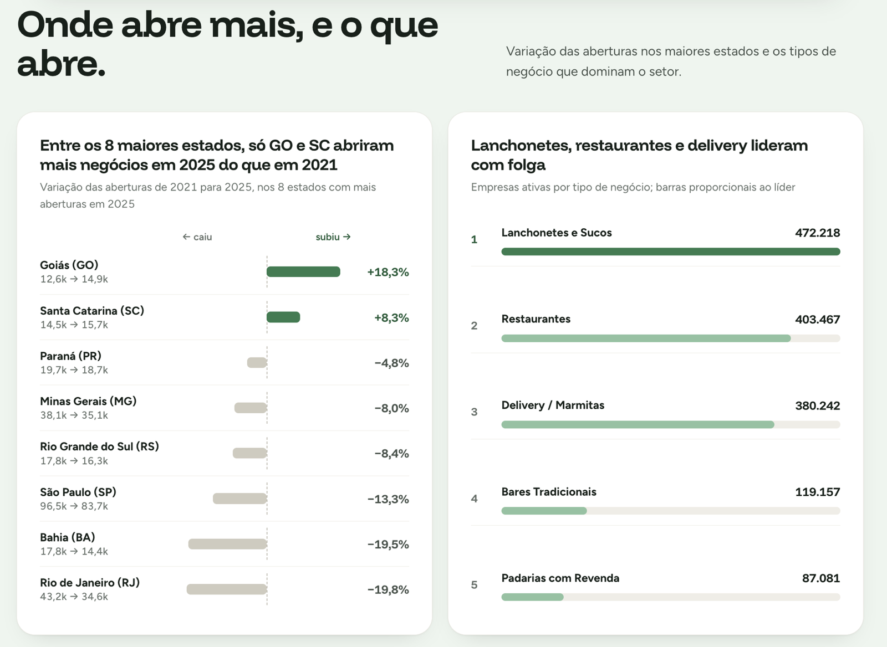

# Alimentação Fora do Lar no Brasil — Panorama CNPJ

Análise nacional do setor de bares, restaurantes e alimentação fora do lar, usando os dados abertos de CNPJ da Receita Federal (competência 2026-08).

[**Abrir dashboard publicado**](https://christiano-gonara.github.io/cnpj-alimentacao/) · [**API e endpoints**](#api) · [**Baixar base tratada (Parquet)**](https://github.com/christiano-gonara/cnpj-alimentacao/releases/latest)



## Capturas de tela

<table>
  <tr>
    <th>Panorama</th>
    <th>Perfil do setor</th>
  </tr>
  <tr>
    <td align="center"></td>
    <td align="center"></td>
  </tr>
  <tr>
    <th>Aberturas e capital</th>
    <th>Estados e atividades</th>
  </tr>
  <tr>
    <td align="center"></td>
    <td align="center"></td>
  </tr>
</table>

## Perguntas respondidas

| Pergunta | Resposta |
|---|---|
| Quantas empresas do setor estão ativas hoje? | **1.511.132 empresas** ativas, em 1.543.267 estabelecimentos. |
| Como evoluiu a abertura nos últimos 5 anos? | **1.507.905 empresas abertas** entre 2021 e 2025. O pico foi em 2021 (356.849) e 2025 encerrou com 315.376 aberturas. |
| Qual é o porte predominante? | **MEI: 63,1%** das empresas ativas; Microempresa (ME): 32,2%; EPP: 3,9%. |

## Estrutura

- [`web/`](web): dashboard executivo, uma página estática publicada no GitHub Pages.
- [`scripts/`](scripts): pipeline de dados. `01_ingestao.py` converte os arquivos da Receita, `02_tratamento.py` limpa, junta e gera a base do setor, `03_base_api.py` gera a versão enxuta que a API consulta.
- [`api/`](api): API em FastAPI, em camadas (rotas, serviço, repositório).
- [`tests/`](tests): testes da API sobre uma base pequena com números conhecidos.
- [`dados/amostra/amostra_base_afl.csv`](dados/amostra/amostra_base_afl.csv): amostra pública com 20 mil linhas.
- [Release](https://github.com/christiano-gonara/cnpj-alimentacao/releases/latest): base nacional completa em Parquet.

## Decisões técnicas

- Foram processadas as **10 partes nacionais** de Empresas e Estabelecimentos: uma parte isolada não cobre os cinco anos de forma confiável.
- O MEI foi identificado pela tabela do **Simples Nacional**, pois não aparece no campo de porte padrão da Receita.
- **DuckDB + Parquet** foram usados para tratar 72,8 milhões de estabelecimentos sem carregar toda a base na memória.

## API

Indicadores do setor com filtros, servidos a partir da base tratada. Devolve só agregados: razão social, endereço e CNPJ completo ficam fora da base da API, porque boa parte dos MEI tem o nome e o endereço de casa do titular nesses campos.

Todos os endpoints de indicadores e rankings aceitam os filtros `uf`, `municipio` (código da Receita), `atividade` (CNAE) e `porte` (`MEI`, `Microempresa`, `Empresa de pequeno porte`, `Demais`). Os de série aceitam também `ano_de` e `ano_ate` (padrão 2021 a 2025).

| Endpoint | O que responde |
|---|---|
| `GET /opcoes` e `/opcoes/municipios?uf=` | valores aceitos em cada filtro |
| `GET /indicadores/resumo` | empresas e estabelecimentos ativos |
| `GET /indicadores/aberturas` | aberturas por ano |
| `GET /indicadores/saldo` | aberturas, fechamentos e saldo por ano |
| `GET /indicadores/sobrevivencia` | dos abertos em cada ano, quantos seguem ativos; mediana de tempo até fechar |
| `GET /indicadores/motivos-fechamento` | por que as empresas fecharam |
| `GET /indicadores/porte` | empresas ativas por porte |
| `GET /rankings/{estado,municipio,atividade,bairro}` | estabelecimentos ativos por dimensão (bairro exige `municipio`) |
| `GET /nomes` | palavras mais usadas no nome fantasia |

Exemplo: bares sem entretenimento abertos no Paraná, `/indicadores/aberturas?uf=PR&atividade=5611204`. A documentação interativa fica em `/docs`.

```bash
python3 -m venv .venv
.venv/bin/pip install -r requirements-dev.txt
.venv/bin/python scripts/03_base_api.py        # precisa de dados/tratados/base_afl.parquet
.venv/bin/uvicorn api.main:criar_app --factory --reload
.venv/bin/pytest                                # não precisa da base real
```

<details>
<summary>Como reproduzir a base tratada</summary>

```bash
python3 -m venv .venv
.venv/bin/pip install -r requirements-dev.txt
.venv/bin/python scripts/01_ingestao.py
.venv/bin/python scripts/02_tratamento.py
```

Os arquivos públicos devem ser baixados do [portal de dados abertos da Receita Federal](https://arquivos.receitafederal.gov.br/index.php/s/gn672Ad4CF8N6TK?dir=/Dados/Cadastros/CNPJ) para `dados/brutos/` antes de executar o pipeline.

</details>
