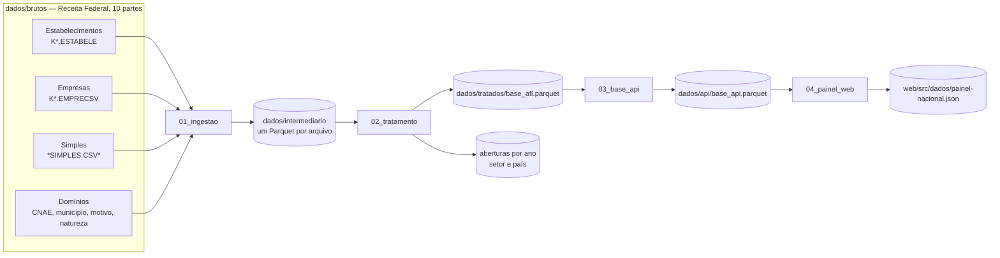
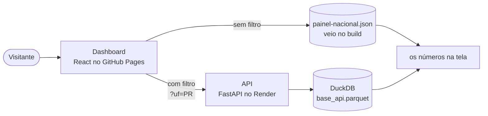

# Arquitetura: do arquivo bruto ao número na tela

O projeto tem dois caminhos, que rodam em momentos diferentes. O primeiro roda **uma vez**, na sua máquina, e transforma os arquivos da Receita em bases enxutas. O segundo roda **a cada visita** e só lê essas bases.

## 1. O caminho do dado

| Script | O que lê | O que grava |
|---|---|---|
| `01_ingestao.py` | os CSVs em Latin-1 | um Parquet por arquivo, em `dados/intermediario/` |
| `02_tratamento.py` | os Parquet intermediários | `base_afl.parquet` (o setor) e as séries de aberturas |
| `03_base_api.py` | `base_afl.parquet` | `base_api.parquet`, só com colunas de agregado |
| `04_painel_web.py` | `base_api.parquet`, pelo serviço da API | `painel-nacional.json` |

O `01` só converte: nada de regra de negócio, e um Parquet por parte para poder retomar de onde parou. O `02` é onde as regras moram: junta Estabelecimentos com Empresas, com o Simples (é de lá que sai o MEI) e com os domínios (para trocar código por nome), e filtra os 6 CNAEs do setor. O `03` deixa de fora razão social, logradouro, CEP e CNPJ completo, porque a API só devolve agregado.

## 2. O caminho de quem visita

Sem filtro, o dashboard abre o JSON que veio no build: nenhuma requisição, e a página aparece mesmo com o servidor dormindo. Os números são os mesmos que a API devolveria, porque esse JSON é gerado pelo serviço da própria API.

Com filtro, o dashboard consulta a API, que responde lendo `base_api.parquet` com DuckDB (350 MB de limite de memória, por causa do plano grátis). A API dorme quando fica parada: passados 4 segundos sem resposta, a página avisa que a primeira consulta pode demorar; se falhar, mostra o erro com o botão de tentar de novo.

## Dois detalhes que explicam o deploy

- `base_api.parquet` (87 MB) não fica no git: vai anexado à release, e o `render.yaml` baixa esse arquivo durante o build.
- O endereço da API no dashboard vem de `VITE_API_URL`, preenchido com a variável `API_URL` do repositório. Se o Render mudar o nome do serviço, é essa variável que muda.
